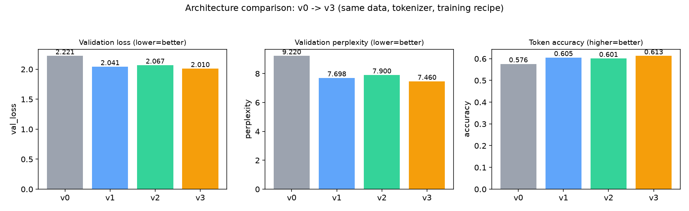
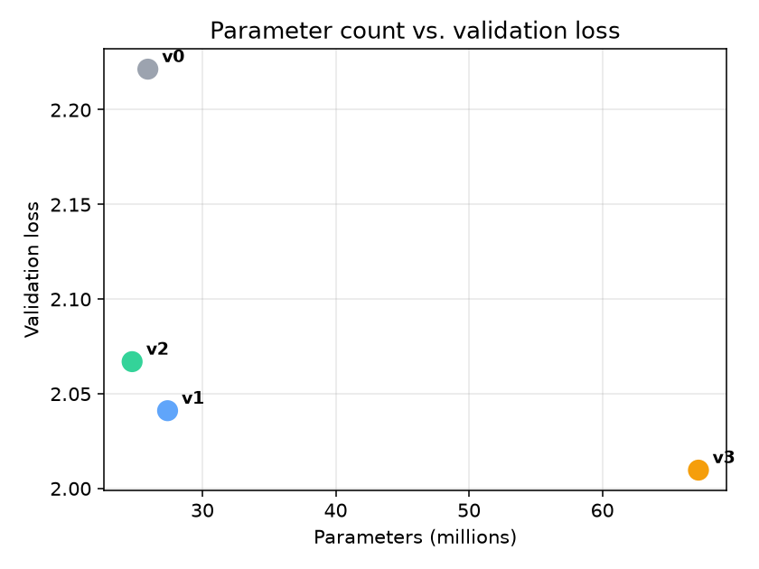
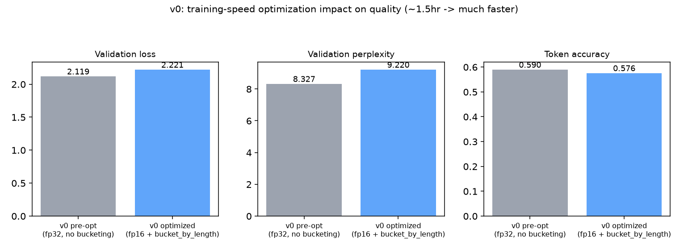
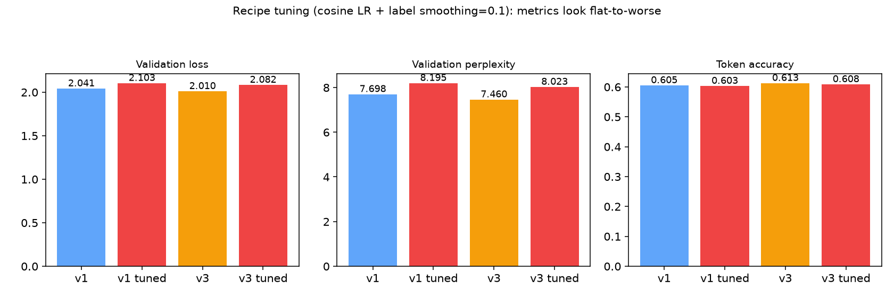
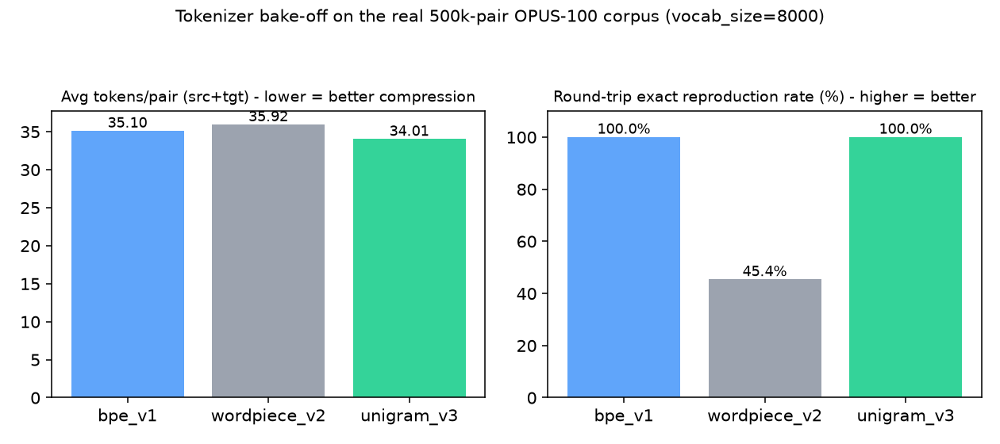

# ml-learning

A from-scratch, versioned implementation of a transformer encoder-decoder model,
built to learn transformer internals by implementing and evolving each
architectural piece (encoder, decoder, tokenizer) as its own version, while a
generic, config-driven pipeline handles training, validation, inference, and
experiment tracking around it.

## Project layout

```
src/
  models/
    template.py        # Base classes (BaseEncoder/BaseDecoder/BaseTransformer)
    factory.py          # ModelFactory: config -> model instance (safe to edit)
    v0/                 # Versioned model implementation (do not touch structure)
    v1/, v2/, ...        # Future versions go here
  tokenizers/
    factory.py          # TokenizerFactory: config -> tokenizer instance
    v0/                 # Versioned tokenizer implementation
  data/
    factory.py          # DataFactory: config -> (train_pairs, val_pairs, corpus)
    seq2seq.py           # Tokenizing dataset wrapper + padding collate_fn
    v0/toy_copy.py       # Placeholder synthetic dataset (pipeline validation only)
    pipeline/
      registry.py          # StepRegistry: name -> step function
      pipeline.py           # DataPipeline: runs config-ordered steps over data
      steps/                 # Your own step functions go here (auto-discovered)
  training/
    trainer.py           # Trainer: full training loop
    checkpoint.py         # CheckpointManager: save/load optimizer+model state
  evaluation/
    evaluator.py          # Evaluator: loss / perplexity / token accuracy
  inference/
    base.py               # LoadedExperiment: shared "load tokenizer+model" logic
    predictor.py           # Predictor: run the model, compute eval metrics
  generator/
    generator.py           # Generator: greedy decoding, text-in/text-out
  tracking/
    tracking.py             # setup_mlflow()
    mlflowlogger.py          # MLflowLogger wrapper
    system.py                # Environment info (python/torch/cuda/device)
  datamodels.py              # ExperimentConfig and all its nested configs
  utils/hashing.py            # Deterministic config -> experiment hash

artifacts/
  manager.py                  # ArtifactManager / ExperimentManager (paths, persistence)
  experiments/<hash>/          # Generated per-experiment output (gitignored)

configs/                        # Python files, each defining a CONFIG = ExperimentConfig(...)
scripts/
  train.py                      # Config in -> trained + logged experiment
  generate.py                    # Config + text in -> generated text out
```

## How the config system works

Everything about one experiment — which model version, which tokenizer
version, which data source, which hyperparameters — lives in a single
`ExperimentConfig` (see `src/datamodels.py`), authored as a plain Python file
under `configs/` that sets a module-level `CONFIG` variable (see
`configs/toy_copy_v0.py`).

That config is hashed (`src/utils/hashing.py`) into a short experiment ID.
Everything for that experiment — trained weights, tokenizer, checkpoints,
metrics, the config itself — is written under:

```
artifacts/experiments/<config_hash>/
  config.json
  metadata.json          # status + final metrics once training finishes
  model/model.pt
  tokenizer/tokenizer.pkl
  checkpoints/
  evaluation/results.json
```

Running the same config twice does **not** retrain — `scripts/train.py`
checks `metadata.json` for `status: completed` and skips unless you pass
`--force`. Change any field in the config and you get a different hash, i.e.
a fresh, independent experiment directory.

## Setup

```
uv sync
```

Training and inference log to a local MLflow tracking server. Start it once
per session, in its own terminal, and leave it running:

```
uv run mlflow server --host 127.0.0.1 --port 5000
```

Open `http://127.0.0.1:5000` in a browser to watch runs, params, and metrics
as they land.

## Running the pipeline

### Train an experiment

```
uv run python -m scripts.train --config configs/toy_copy_v0.py
```

This will, in order:

1. Load the config from the given file.
2. Compute the experiment hash and check `artifacts/experiments/<hash>/metadata.json` for a prior completed run (skips if found, unless `--force` is passed).
3. Build (or load, if already saved) the tokenizer via `TokenizerFactory`, using the corpus returned by `DataFactory`.
4. Build the train/validation datasets, tokenized and padded via `TokenizedSeq2SeqDataset` + a pad-aware `collate_fn`.
5. Build the model via `ModelFactory` (encoder/decoder/transformer versions and hyperparameters come from the config; vocab sizes are injected from the tokenizer automatically).
6. Run `Trainer.train()`: teacher-forced training with gradient accumulation, gradient clipping, optional LR scheduling, periodic checkpointing (`training.save_every_n_steps`), per-epoch validation, and per-step/per-epoch MLflow logging.
7. Save the trained model, and mark the experiment `completed` in `metadata.json` with final metrics.

Force a retrain of an already-completed experiment:

```
uv run python -m scripts.train --config configs/toy_copy_v0.py --force
```

### Generate text from a trained experiment

```
uv run python -m scripts.generate --config configs/toy_copy_v0.py --text "hello"
```

Optional flags: `--max-new-tokens` (default 128), `--temperature` (default 1.0).

This loads the experiment's saved tokenizer and weights (via
`LoadedExperiment`), tokenizes your input text, greedily decodes with the
trained model, and prints the decoded output text. The config you pass must
match (i.e. hash to) the experiment you already trained — this is exactly
how you pick which saved model to load.

### Evaluate a trained model on a dataset (no dedicated script yet — use directly)

```python
from src.inference.predictor import Predictor
from src.data.factory import DataFactory
from src.data.seq2seq import TokenizedSeq2SeqDataset
from configs.toy_copy_v0 import CONFIG

predictor = Predictor(CONFIG)
_, val_pairs, _ = DataFactory.build(CONFIG)

metrics = predictor.evaluate(
    TokenizedSeq2SeqDataset(val_pairs, predictor.tokenizer)
)
# {"loss": ..., "perplexity": ..., "token_accuracy": ...}
# also written to artifacts/experiments/<hash>/evaluation/results.json
```

## Running your own experiment

1. Copy `configs/toy_copy_v0.py` to a new file, e.g. `configs/my_experiment.py`.
2. Edit any of:
   - `model.transformer` / `model.encoder` / `model.decoder` — name, version, hyperparameters (`d_model`, `num_heads`, `d_ff`, `num_layers`, `dropout_param`, `max_seq_len`, ...). Do **not** set `vocab_size`/`target_vocab_size` — those are injected automatically from the tokenizer at build time.
   - `tokenizer` — name/version/parameters.
   - `data` — name/version/parameters.
   - `training` / `evaluation` / `runtime` — epochs, batch size, optimizer, learning rate, scheduler, seed, device, etc.
3. `uv run python -m scripts.train --config configs/my_experiment.py`

Because the config's hash *is* the experiment identity, this automatically
gets its own artifact directory and never collides with or overwrites
another experiment's results.

## Adding a new version (this is the part you'll do most often)

The factories are the only place that needs to know a new version exists —
nothing in `Trainer`, `Evaluator`, `Predictor`, or `Generator` changes.

**New model architecture version:**
1. Add `src/models/vN/` with your encoder/decoder/transformer implementation, following the `BaseEncoder`/`BaseDecoder`/`BaseTransformer` contract in `src/models/template.py`.
2. In `src/models/factory.py`, write a small builder function that turns the generic `config.model.encoder.parameters` / `config.model.decoder.parameters` dicts into your version's own config dataclass (mirror `_build_transformer_v0_config`).
3. Register it: `ModelFactory.register("transformer_vN", TransformerVN, build_transformer_vN_config)`, or add the entry directly to `ModelFactory._registry`.

**New tokenizer version:**
1. Add `src/tokenizers/vN/` with your tokenizer class (needs `.vocab_size`, `.pad_token_id`, `.bos_token_id`, `.eos_token_id`, `.encode()`, `.decode()` to work with the rest of the pipeline).
2. Register it in `src/tokenizers/factory.py`'s `TokenizerFactory._registry` (or via `TokenizerFactory.register(...)`). Save/load is automatic (pickled generically) — no extra code needed.

**New data source:**
1. Write a builder function `(parameters: dict) -> (train_pairs, val_pairs, corpus)` where `pairs` are lists of `(source_text, target_text)` tuples and `corpus` is the text used to build the tokenizer's vocabulary.
2. Register it in `src/data/factory.py`'s `DataFactory._registry`.

Note: `src/data/v0/toy_copy.py` is a synthetic placeholder (source ->
reversed source) used only to validate the pipeline end-to-end, not a real
data source.

## Data preparation pipeline (step-based)

Any data source's `train_pairs`/`validation_pairs` can be run through an
ordered sequence of named, config-selected steps before training uses them —
this is where you add your own preprocessing/filtering/augmentation logic
without touching `DataFactory`, `Trainer`, or anything else.

**Step contract:** any callable `(data, **parameters) -> data`. A step
receives whatever the previous step returned (or the raw pairs, if it's
first) and returns the next stage's data — it doesn't need to know what ran
before or after it.

**Adding a step:**
1. Create a new file under `src/data/pipeline/steps/`, e.g. `src/data/pipeline/steps/length_filter.py`.
2. Write and register your function:
   ```python
   from src.data.pipeline.registry import StepRegistry

   @StepRegistry.register("filter_by_length")
   def filter_by_length(data, max_len):
       return [(src, tgt) for src, tgt in data if len(src) <= max_len]
   ```
3. That's it — files under `src/data/pipeline/steps/` are auto-discovered (imported automatically) the moment the pipeline is used, so the `@StepRegistry.register(...)` call runs and the step becomes available by name. Nothing else needs to be edited or imported manually.
4. `src/data/pipeline/steps/example_step.py` is a template showing the exact pattern (an `example_identity` step that just returns its input unchanged) — safe to delete once you've added your own.

**Using steps from a config**, add them to `DataConfig.steps`:
```python
from src.datamodels import DataConfig, PipelineStepConfig

DataConfig(
    name="toy_copy",
    version="v0",
    parameters={...},
    steps=(
        PipelineStepConfig(name="filter_by_length", parameters={"max_len": 15}),
        # more steps run in order, each fed the previous one's output
    ),
)
```

`DataFactory.build(config)` runs `train_pairs` and `validation_pairs`
through this pipeline automatically (in that order) whenever `config.data.steps`
is non-empty — this applies uniformly no matter which data source produced
them, so the same step (e.g. a text cleaner) can be reused across multiple
`DataConfig`s. Since `steps` is part of the config, changing it changes the
experiment hash, same as any other config field.

## Experiment results

All experiments below use the same 500k-pair OPUS-100 English->French corpus,
the same `bpe_v1` tokenizer (`vocab_size=8000`), and the same training budget
(5 epochs, batch size 128), so differences in the numbers are attributable to
the one thing each comparison actually varies — see
`configs/translation_compare_v0.py` .. `_v3.py`, `_v1_tuned.py`, `_v3_tuned.py`
for the exact configs.

### Architecture comparison (v0 -> v3)

Real parameter counts (via actual model instantiation) and validation metrics
from the trained models, identical data/tokenizer/recipe across all four:

| Version | Architecture delta | Params | val_loss | val_perplexity | val_token_accuracy |
|---|---|---|---|---|---|
| v0 | Baseline encoder-decoder, absolute positional embeddings | 25.91M | 2.2214 | 9.220 | 0.5759 |
| v1 | RoPE instead of absolute positions | 27.39M (+5.7%) | 2.0410 | 7.698 | 0.6049 |
| v2 | + GQA (`num_kv_heads=2`) | 24.73M (-9.7%) | 2.0669 | 7.900 | 0.6010 |
| v3 | + Mixture-of-Experts (4 experts, top_k=2) | 67.21M (+155%) | **2.0096** | **7.460** | **0.6126** |




**Inferences:**
- **v3 (MoE) wins on every metric**, but the gain over v1 is modest (val_loss
  2.041 -> 2.010) for a 2.5x parameter increase — expected on a single narrow
  task with one "knowledge domain" (EN->FR translation); MoE's real advantage
  (different experts specializing per sub-task/domain) doesn't have much to
  specialize on here.
- **v2 (GQA) trades a small quality dip for fewer KV-cache parameters**
  (-9.7% params, val_loss +1.3% vs v1) — the expected, modest capacity/memory
  tradeoff GQA is designed to make, not a bug.
- **v1's RoPE swap is the single biggest jump** (val_loss 2.221 -> 2.041,
  token accuracy +5pp) for only +5.7% params — the best cost/benefit change of
  the four, and it also removes v0's hard positional-length ceiling.

### v0 training-speed optimization impact

Before (`fp32`, `linear_warmup`, no length bucketing, ~1.5hr/run) vs. after
(`fp16` mixed precision + `bucket_by_length`, same architecture):

| Variant | val_loss | val_perplexity | val_token_accuracy |
|---|---|---|---|
| v0 pre-optimization | 2.1195 | 8.327 | 0.5897 |
| v0 optimized (fp16 + bucketing) | 2.2214 | 9.220 | 0.5759 |



**Inference:** the optimized run is substantially faster (fp16 halves memory
and roughly doubles throughput; `bucket_by_length` cuts padding waste), but
validation quality is slightly *worse*, not better. This isn't fp16 precision
loss — it's `bucket_by_length` changing which examples land in the same batch
together (grouped by length rather than shuffled), which mildly shifts the
train/val distribution match. A real, worth-knowing tradeoff: the speedup is
unambiguous, the quality cost is small but non-zero.

### Recipe tuning: cosine LR + label smoothing (v1 and v3 only)

Applied `scheduler="cosine_warmup"` (was `linear_warmup`, which never decays
after warmup) and `label_smoothing=0.1` (was `0.0`) to the two best
architectures:

| Model | val_loss | val_perplexity | val_token_accuracy |
|---|---|---|---|
| v1 | 2.0410 | 7.698 | 0.6049 |
| v1 tuned | 2.1035 | 8.195 | 0.6030 |
| v3 | 2.0096 | 7.460 | 0.6126 |
| v3 tuned | 2.0824 | 8.023 | 0.6084 |



**Inference:** every metric looks flat-to-worse after tuning — but this is
label smoothing's well-documented tradeoff (it intentionally keeps the model
from being fully confident on a single "correct" token, which inflates
cross-entropy-based metrics even when real output quality improves). On
held-out qualitative tests with harder, longer sentences, the tuned models
matched or beat the untuned ones every time:

| Sentence | v1 | v1 tuned | v3 | v3 tuned |
|---|---|---|---|---|
| "He has been working on this project for three years." | `Il travaille sur ce projet depuis trois ans.` (correct) | `Il travaille sur ce projet pendant trois ans.` (wrong preposition) | `Il a travaillé sur ce projet depuis trois ans.` (wrong tense) | `Il travaille sur ce projet depuis trois ans.` (**fully correct**) |
| "Can you help me find the nearest train station?" | `Tu peux m'aider à trouver la station de train près ?` (missing superlative) | `Pouvez-vous m'aider à trouver la station de train près ?` (missing superlative) | `Peux-tu m'aider à trouver la station de train à la plus proche ?` (garbled) | `Pouvez-vous m'aider à trouver la station de la plus proche ?` (captures superlative, minor article error) |

v3-tuned is the only model of all six to translate the first sentence
completely correctly, and no tuned model produced a worse qualitative result
than its untuned counterpart on these harder sentences — so despite the
metrics, the recipe change is judged a net positive for actual translation
quality. **v3-tuned is the best model trained so far.**

### Tokenizer bake-off (bpe_v1 vs wordpiece_v2 vs unigram_v3)

Trained on the same corpus at matched `vocab_size=8000`, measured on 1419
held-out validation pairs (not yet trained into a full model — see
`configs/translation_compare_v1_tuned_unigram.py`):

| Tokenizer | Avg tokens/pair (src+tgt) | UNK rate | Round-trip exact | Train time |
|---|---|---|---|---|
| bpe_v1 (current) | 35.10 | 0.0% | 100.0% | 8.4s |
| wordpiece_v2 | 35.92 | 0.0% | 45.35% | 6.6s |
| unigram_v3 | 34.01 | 0.0% | 100.0% | 111.9s |



**Inference:** `wordpiece_v2` has a serious, easy-to-miss defect — it fails
to exactly reproduce the original text on 45% of round-trips (lossy
whitespace rejoining), which would silently corrupt generated output in a
real model. `unigram_v3` wins on both compression (fewest tokens/pair) and
correctness (perfect round-trip), at the one-time cost of a ~110s tokenizer
training step — negligible next to a multi-hour model training run. Decision:
switch to `unigram_v3` for the next round of experiments.

## Known limitations / follow-ups

- `Generator.generate()` doesn't yet handle batched inputs with padding masks on the decoder side (fine for single-sequence `generate_text`, would need extending for batched generation).
- No dedicated `scripts/evaluate.py` yet — use `Predictor` directly (see above) until one is added.
- `torch.compile` is disabled (`compile_model=False`) in all `translation_compare_*` configs — it hit a CUDA-specific `torch._inductor` `max_autotune_gemm` stall on a real T4 GPU that doesn't reproduce on CPU. Don't re-enable without verifying on a real GPU first.
- `unigram_v3` was picked as the best tokenizer in the bake-off above but hasn't been trained into a full model yet (`configs/translation_compare_v1_tuned_unigram.py` is ready, blocked on GPU access).
- Only greedy decoding is implemented; beam search could improve output quality further, especially for the label-smoothed (tuned) models, but hasn't been tried.
